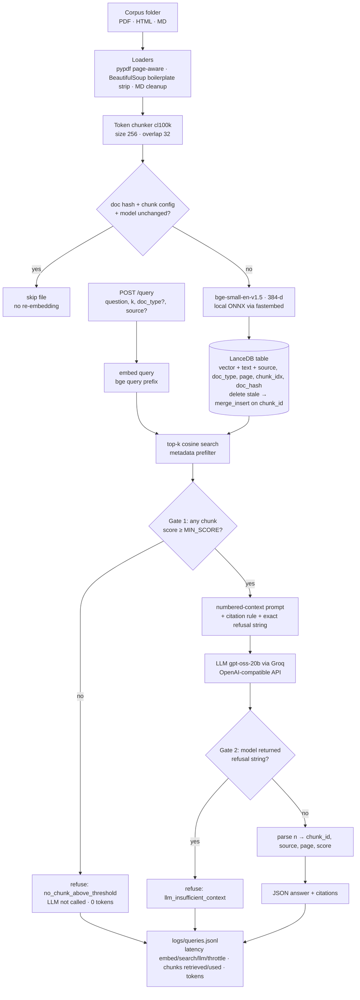

# P1 — Cost-Efficient RAG on LanceDB

A question-answering service over a mixed PDF / HTML / Markdown corpus, backed by **LanceDB**
(embedded, file-based, no always-on server). Every claim below is backed by a file in [`results/`](results/)
that a script in this repo regenerates.

## Architecture



## Setup (≈5 minutes)

**Prerequisites:** Python 3.11+ (tested 3.13.15), Windows/macOS/Linux, ~1 GB disk, internet for the
first model download. No GPU, no Docker, no database server. A free [Groq](https://console.groq.com) API key
(or a local Ollama — any OpenAI-compatible endpoint works).

```bash
git clone https://github.com/gamea333/synlabs_io_assignment && cd synlabs_io_assignment/p1_rag
python -m venv .venv
.venv/Scripts/activate            # Windows   (macOS/Linux: source .venv/bin/activate)
pip install -r requirements.txt
cp .env.example .env              # then put your key in LLM_API_KEY
python scripts/fetch_corpus.py    # downloads the 5 arXiv PDFs (HTML/MD snapshots are committed)
```

**Environment variables** (all in `.env.example`, no secrets committed):
`LLM_BASE_URL`, `LLM_API_KEY`, `LLM_MODEL`, `JUDGE_MODEL`, `EMBED_MODEL`, `CHUNK_SIZE`, `CHUNK_OVERLAP`,
`TOP_K`, `MIN_SCORE`, `LANCEDB_URI`, `LANCEDB_TABLE`, `LOG_PATH`.

## Run

```bash
# Ingest (defaults: 256-token chunks, 32-token overlap). Re-running is a no-op.
python -m app.cli ingest data/corpus
python -m app.cli stats                               # vector count + duplicate check

# HTTP API
uvicorn app.api:app --port 8000
curl -X POST localhost:8000/query -H "Content-Type: application/json" \
     -d '{"question": "How many layers does the Transformer encoder have?", "k": 5}'
curl -X POST localhost:8000/query -H "Content-Type: application/json" \
     -d '{"question": "What is the default ef_search in pgvector?", "doc_type": "md"}'   # metadata filter

# or CLI
python -m app.cli query "What is HNSW?" -k 5 --doc-type pdf
```

Endpoints: `POST /query`, `POST /ingest`, `GET /stats`, `GET /health`.

## Reproduce every number

| Command | Output | Time |
|---|---|---|
| `python -m eval.run_eval` | `results/eval_results.json` — retrieval + answer + latency (all 3 layers, with full judge audit log) | ~20 min (Groq free-tier rate limit) |
| `python -m eval.run_eval --retrieval-only` | retrieval layer only, no LLM calls | ~30 s |
| `python -m eval.sweep` | `results/chunk_sweep.json` — 6 chunk configs × IR metrics, k = 1/3/5/10 | ~8 min |
| `python -m eval.bench_stores` | `results/store_benchmark.json` — LanceDB vs FAISS at 100K / 1M | ~15 min |
| `python -m cost.cost_model` | `results/cost_comparison.{json,md}` | instant |

## Project layout

```
app/        config.py (env) · loaders.py · chunking.py · embeddings.py · store.py (LanceDB)
            ingest.py (idempotent) · llm.py (OpenAI-compatible, measured retries) · rag.py · api.py · cli.py
eval/       gold.json (27 Qs) · metrics.py · judge.py · run_eval.py · sweep.py · bench_stores.py
cost/       cost_model.py
results/    every metric file quoted in this README
docs/       screenshots
```

## Results

**Setup for all numbers:** 15 docs (5 PDF, 5 HTML, 5 MD) → 463 chunks of 256 tokens / 32 overlap,
`BAAI/bge-small-en-v1.5` (384-d), k = 5, LanceDB exact cosine search, generator `openai/gpt-oss-20b`,
judge `qwen/qwen3.8-27b` (both via Groq). Hardware: AMD Ryzen 7 5800H (8C/16T), 15.4 GB RAM, NVMe, Windows 11.
Gold set: [`eval/gold.json`](eval/gold.json), 27 questions = 23 answerable (22 single-fact, 1 needing two docs) + 4 unanswerable
(1 off-topic, 3 on-topic but not in the corpus).

### 1. Retrieval ([`results/eval_results.json`](results/eval_results.json) → `retrieval`)

**Relevance definition.** Each answerable question lists the fact(s) it needs; each fact has a source document and one
or more verbatim answer-bearing quotes. A chunk is relevant iff it is from that source and contains one of the quotes
(after NFKC + whitespace + case normalisation). Quotes were found by searching the *whole* source document for every
passage stating the fact, so labels don't depend on chunk size and aren't biased toward what the retriever returned.

| Metric (k = 5) | Value | How computed |
|---|---|---|
| Hit rate @5 | **0.870** | question has ≥1 relevant chunk in top-5 (20/23) |
| Fact recall @5 | 0.870 | fraction of required facts covered (matters for the 2-doc question) |
| Recall @5 | 0.665 | relevant chunks in top-5 / all relevant chunks in the index (overlap can make a fact appear in 2–3 chunks) |
| MRR | **0.750** | 1 / rank of first relevant chunk, 0 if none |
| nDCG @5 | 0.649 | binary gains, log2 discount, ideal = min(#relevant, 5) |
| Context precision | 0.733 | RAGAS rank-weighted: mean of precision@i over relevant ranks i |
| Precision @5 | 0.252 | relevant chunks / 5 (ceiling is ~0.2–0.4 since most questions have 1 relevant chunk) |

**Chunking sweep** ([`results/chunk_sweep.json`](results/chunk_sweep.json), same gold set, k = 5):

| Size / overlap | Vectors | Context tokens @5 | Hit@5 | Recall@5 | MRR | nDCG@5 | Ctx precision |
|---|---|---|---|---|---|---|---|
| 128 / 16 | 921 | 640 | 0.783 | 0.638 | 0.601 | 0.574 | 0.555 |
| **256 / 32** | **463** | **1,280** | **0.870** | 0.665 | **0.750** | **0.649** | **0.733** |
| 512 / 0 | 207 | 2,560 | 0.826 | **0.705** | 0.681 | 0.623 | 0.644 |
| 512 / 64 | 233 | 2,560 | 0.739 | 0.593 | 0.628 | 0.545 | 0.584 |
| 512 / 128 | 269 | 2,560 | 0.826 | 0.580 | 0.661 | 0.538 | 0.640 |
| 1024 / 128 | 119 | 5,120 | 0.826 | 0.694 | 0.565 | 0.537 | 0.535 |

**k sweep** at 256/32: Hit@k 0.652 / 0.826 / **0.870** / 0.913 and MRR 0.652 / 0.739 / 0.750 / 0.755 for k = 1 / 3 / 5 / 10.
k = 5 → 10 gains one question for 2× the prompt tokens.

### 2. Answer quality ([`results/eval_results.json`](results/eval_results.json) → `answers`)

| Metric | Value | Method |
|---|---|---|
| Faithfulness | **1.000** (22 answered) | judge splits answer into atomic claims, labels each supported/unsupported vs the exact context the generator saw; score = supported / total |
| Answer relevance | 0.957 (23 answerable) | judge 1–5 "does it address the question", mapped to 0–1; a refusal scores 0 |
| Correctness vs gold | **0.870** (20/23) | judge: is the answer consistent with the reference answer |
| Exact match | 0.000 | SQuAD normalisation (+ number words). The generator answers in sentences, so EM is structurally ~0 |
| Token F1 | 0.217 | SQuAD token F1 vs the short gold answer — penalises full-sentence answers |
| Contains-gold | 0.478 | normalised gold string appears inside the answer |
| Correct refusals (unanswerable) | **4/4** | all via gate 2 (see below) |
| False refusals (answerable) | 1/23 | q13 — evidence retrieved at rank 2 but model refused |

**Is the faithfulness judge actually discriminating?** ([`results/judge_probe.json`](results/judge_probe.json))
We corrupted the real answers and re-judged them against the same context:

| Variant | n | Mean faithfulness | Flagged (< 1.0) |
|---|---|---|---|
| Original answers | 22 | 1.000 | 0 % (no false alarms) |
| First number swapped for a wrong one | 14 | 0.262 | **100 %** |
| + one fabricated, cited sentence | 22 | 0.514 | **100 %** |

So 1.000 reflects a generator that stays inside its context, not a rubber-stamp judge. Limitation: faithfulness
checks claims against context, not fit to the question — q18 is "faithful" but answers the wrong variant
(half-precision limit instead of the `vector` limit); correctness (0.870) is what catches that.

### 3. Latency

| Metric | p50 | p95 | Conditions |
|---|---|---|---|
| Vector search only | **16.0 ms** | **21.7 ms** | LanceDB exact cosine, 463 vectors, k = 5, 540 warm queries (27 Qs × 20) |
| Query embedding + search | 30.3 ms | 41.4 ms | + bge-small ONNX on CPU |
| End-to-end, excluding provider throttling | 529 ms | 687 ms | 27 queries incl. LLM generation (~1.6K prompt tokens) |
| End-to-end wall clock | 529 ms | 1,755 ms | includes waits on Groq free-tier 429s (8K tokens/min) |

Retrieval is ~3 % of end-to-end latency; the LLM is the rest.

### 4. Cost ([`cost/cost_model.py`](cost/cost_model.py) → [`results/cost_comparison.md`](results/cost_comparison.md))

| Vectors | LanceDB self-hosted ($/mo) | Pinecone p1 pods | Pinecone s1 pods | Pinecone serverless @100K q/mo | Savings vs p1 pods / vs serverless |
|---|---|---|---|---|---|
| 100K | **$26.14** (t4g.medium + 20 GB gp3) | $81.03 (1 pod) | $81.03 (1) | $50.00 (plan minimum) | 68 % / 48 % |
| 1M | **$26.21** (t4g.medium + 20 GB gp3) | $162.06 (2 pods) | $81.03 (1) | $50.00 (plan minimum) | 84 % / 48 % |
| 10M | **$83.52** (r7g.large + 56 GB gp3) | $1,053.39 (13 pods) | $243.09 (3) | $101.83 | 92 % / 18 % |

Serverless sensitivity to query volume (serverless charges 1 read unit per GB of namespace **per query**):

| Vectors | 10K q/mo | 100K q/mo | 1M q/mo | 10M q/mo | LanceDB | Serverless cheaper below |
|---|---|---|---|---|---|---|
| 100K | $50 | $50 | $50 | $60 | $26 | never ($50 floor) |
| 1M | $50 | $50 | $64 | $601 | $26 | never ($50 floor) |
| 10M | $50 | $102 | $639 | $6,010 | $84 | **~69K queries/mo** |

**Assumptions** (all named constants in `cost/cost_model.py`, prices checked 2026-10-17, USD, AWS us-east-1, on-demand, 730 h/mo):
- Record = **3,730 B, measured** from our table: 384-d float32 vector (1,536 B) + chunk text (~1,983 B) + metadata (~211 B). Same record stored in Pinecone.
- Pinecone serverless Standard: $50/mo minimum, $0.33/GB-mo storage, $16/M read units, $4/M write units (low end of published range); 1 RU per GB of namespace per query (min 0.25); writes 1 WU/KB, and overwrites also pay for the old record's KB; 10 % of vectors re-upserted per month.
- Pinecone pods (legacy, closed to new sign-ups since Aug 2025, but the model the brief describes): $0.111/h for s1.x1 or p1.x1; capacity converted to bytes from "5M / 1M 768-d vectors, no metadata"; 1 replica (no HA, matching our single node).
- LanceDB: the whole VM is charged to the vector store (overstates our cost; Pinecone also needs an app server). t4g.medium $0.0336/h, r7g.large $0.1071/h, gp3 $0.08/GB-mo at 1.5× data size (index files + versions), S3 backup $0.023/GB-mo. Above ~100K vectors an IVF_PQ index is required (see benchmark).
- Not modelled: egress, ops/on-call time, HA replicas on either side, reserved/savings-plan discounts (−30–40 % on EC2).

### 5. Bonus — second store: FAISS vs LanceDB at scale ([`results/store_benchmark.json`](results/store_benchmark.json))

384-d vectors, top-10, 27 real query embeddings × 5 reps, same laptop. Vectors are synthetic but clustered
(real corpus embeddings + Gaussian noise); recall is vs exact search.

| N | Store / mode | p50 ms | p95 ms | Recall@10 | Build | Footprint |
|---|---|---|---|---|---|---|
| 100K | FAISS flat (RAM) | 12.3 | 14.5 | 1.000 | 0.03 s | 154 MB RAM |
| 100K | FAISS HNSW M=32 efS=64 | 0.25 | 0.40 | 0.759 | 2.8 s | RAM |
| 100K | LanceDB exact (disk) | 132.9 | 142.8 | 1.000 | 0.4 s | 154 MB disk |
| 100K | LanceDB IVF_PQ nprobes=50 refine=20 | 18.5 | 25.2 | 0.944 | 76 s | 160 MB disk |
| 1M | FAISS flat (RAM) | 186.3 | 200.1 | 1.000 | 0.7 s | 1.5 GB RAM |
| 1M | FAISS HNSW M=32 efS=64 | 0.97 | 1.40 | 0.478 | 123 s | RAM |
| 1M | LanceDB exact (disk) | 1,218 | 1,446 | 1.000 | 98 s | 1.5 GB disk |
| 1M | LanceDB IVF_PQ nprobes=50 refine=20 | 19.1 | 60.5 | 0.915 | 180 s | 1.6 GB disk |

Takeaways: (1) LanceDB brute force is fine at our 463 vectors (16 ms) but not past ~100K — an IVF_PQ index is
mandatory at 1M (19 ms p50, 0.915 recall). (2) FAISS is faster when everything is in RAM, but it is a library, not a
database: no metadata filtering, persistence, or upserts without building them yourself. (3) The low HNSW recall is
partly an artefact of the synthetic data (thousands of near-duplicates per cluster) at efSearch = 64; it is not a
general verdict on HNSW.

## Discussion

**Was retrieval or generation the weak link?** Retrieval, but not by much. Of 23 answerable questions, 3 facts were
never retrieved in the top 5 (q04, q05, q07). q07 then produced a wrong-but-faithful answer from a neighbouring results
table. Generation caused 2 failures: q13 was refused although the author line was retrieved at rank 2 (a noisy
PDF title-page chunk), and q18 picked the wrong number from a correctly retrieved FAQ chunk. No answer contained an
unsupported claim (faithfulness 1.0, verified by the corruption probe). The next fixes I'd make are retrieval-side: hybrid BM25 +
dense search (q05/q07 contain exact strings like "RAG-Token" or "9%-19%" that lexical search would hit), a cross-encoder
re-ranker over the top 20, and a larger embedding model (bge-base, 768-d) at 2× the storage cost.

**Trade-offs we knowingly accept with LanceDB.** One node means no HA and no automatic failover (the replica is an
S3 backup, so recovery is minutes, not seconds). Above ~100K vectors we must build and periodically rebuild an IVF_PQ
index, and we accept ANN recall around 0.92 rather than exact search. Concurrency is limited to one process writing at a
time. Capacity planning, upgrades, compaction (`optimize()` to collapse versions) and monitoring are our job.

**When we would switch back to managed.**
1. **Query volume is high relative to index size and the index is small.** Serverless costs nothing extra up to its $50 floor, so with a
   small index and spiky or unpredictable traffic, managed is simpler for a similar bill.
2. **The opposite of our premise: a large index that is *very* rarely queried.** At 10M vectors and fewer than ~69K
   queries/month, Pinecone serverless ($50–$102) is cheaper than an always-on box ($84). LanceDB-on-S3 behind a
   scale-to-zero function would win back that case, but at the cost of cold-start latency.
3. **We need HA/SLA, multi-region, or many concurrent writers**, or nobody on the team wants to own the operational work.
   An engineer-day per month costs more than the entire 10M-vector bill.

For the brief's scenario (large, lightly queried, steady 100K–1M queries/month), self-hosted LanceDB is 84–92 %
cheaper than pods and 48–87 % cheaper than serverless, at 16–19 ms retrieval latency.

## Known limitations

- 27 questions is small: one question moves Hit@5 by 0.043, and the chunk-sweep differences between the 512 variants
  are within that noise. 256/32 wins on every rank metric, which is why we chose it.
- The judge is a single LLM (different family from the generator) at temperature 0; we did not measure test-retest
  agreement or human agreement for P1. That is P2's job.
- `MIN_SCORE` (gate 1) is set low (0.50) after the gold set showed an answerable question at 0.529, within the
  off-topic range. In this eval gate 1 therefore never fired; all 4 refusals came from gate 2 (the LLM).
- Groq free tier: 8K tokens/min. Wall-clock p95 includes rate-limit waits, reported separately.
