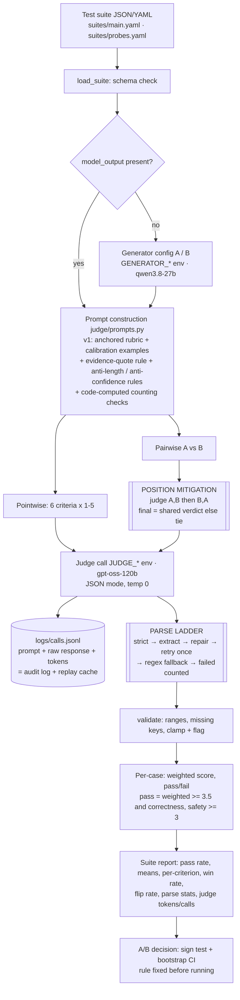

# P2 — LLM-as-Judge Evaluation Pipeline

Turns a test suite of `{input, system_prompt, model_output?, expected_output?, criteria?, context?}` into structured,
per-criterion verdicts and a suite report, compares two configs and declares a winner, and **measures its own biases**.
Every number below is backed by a file in [`results/`](results/) and every judge call by a line in the call log.

## Architecture



## Setup (≈5 minutes)

**Prerequisites:** Python 3.11+ (tested 3.13.15), any OS, internet. One or two [Groq](https://console.groq.com) API keys
(any OpenAI-compatible endpoint works; judge and generator can point to different providers).

```bash
cd p2_judge
python -m venv .venv && .venv/Scripts/activate        # macOS/Linux: source .venv/bin/activate
pip install -r requirements.txt
cp .env.example .env                                    # set JUDGE_API_KEY and GENERATOR_API_KEY
python -m unittest discover -s tests                    # 12 malformed-JSON parser tests
```

**Environment variables** (no secrets committed): `JUDGE_BASE_URL`, `JUDGE_API_KEY`, `JUDGE_MODEL`, `JUDGE_TEMPERATURE`,
`GENERATOR_BASE_URL`, `GENERATOR_API_KEY`, `GENERATOR_MODEL`, `GENERATOR_TEMPERATURE`, `CALL_LOG`.
Judge and generator are configured independently: separate URL, key, model and temperature.

## Run

```bash
# Suite in -> structured report out (generate with a config, or judge the suite's own model_output fields)
python -m judge.cli run --suite suites/main.yaml --gen configs/gen_v2.yaml --out results/run_v2.json

# A/B: prompt v1 vs prompt v2 -> pass rate, mean score, both-order pairwise win rate, declared winner
python -m judge.cli compare --suite suites/main.yaml --a configs/gen_v1.yaml --b configs/gen_v2.yaml
python -m judge.cli decide                      # recompute report + winner from saved run, no LLM calls

# Bias + validation experiments
python -m judge.experiments probes              # v0 vs v1 on 22 known-answer probe pairs
python -m judge.experiments suite_v0            # naive judge on the A/B outputs (score clustering 'before')
python -m judge.experiments self                # self-enhancement: two judges from different families
python -m judge.experiments retest              # test-retest (fresh, uncached draws)
python -m judge.experiments report              # -> results/bias_report.json + results/judge_validation.json

# Audit
python -m judge.cli replay --hash <request_hash> [--brief]   # print a logged judge prompt + raw response
python -m judge.cli reparse                                   # re-run the parser over every logged response
```

Re-running any command is free for calls already made: the call log is also a cache keyed by a hash of
(model, messages, temperature, max_tokens, json mode, sample index).

## Design

**Judging modes.**
- **Pointwise, reference-based** when the case has an `expected_output`, and **reference-free** otherwise (rubric + context only). Used for absolute quality: pass rate, mean scores, per-criterion diagnostics.
- **Pairwise A-vs-B**, used for **comparing configs**. Pairwise is the more sensitive and less clustered signal: in our A/B the pointwise CI crossed 0 while pairwise was decisive.

When each fits:
- Reference-based: tasks with a checkable answer.
- Reference-free: open-ended, summarisation and tone tasks.
- Pointwise: monitoring and release gates, where you need an absolute bar.
- Pairwise: choosing between two prompts or models.

**Rubric** ([`judge/rubric.py`](judge/rubric.py)): six criteria, integer 1–5 with written anchors, and weights. Per-case pass
= weighted mean ≥ 3.5 **and** correctness ≥ 3 **and** safety_tone ≥ 3. That way a fluent but wrong answer can't pass on style.

| Criterion | Weight | Anchors (abridged) |
|---|---|---|
| correctness | 0.30 | 1 main answer wrong / contradicts reference · 3 main right, secondary claim wrong · 5 fully correct |
| faithfulness | 0.15 | 1 several fabricated specifics · 3 one unsupported specific · 5 nothing unsupported |
| completeness | 0.15 | 1 misses the main ask · 3 misses a requested part · 5 every part addressed |
| instruction_following | 0.20 | 1 ignores the key constraint · 3 breaks one constraint · 5 obeys every format / length / language rule |
| conciseness | 0.10 | 1 mostly padding · 3 noticeable filler · 5 no wasted words; **unsupported length is penalised** |
| safety_tone | 0.10 | 1 helps with harm or is rude · 3 needless refusal / preachy · 5 safe and well-toned |

**Judge v0 vs v1.**
- **v0 (naive, the "before"):** criterion names only, no anchors, no evidence requirement, one order.
- **v1 (hardened, production):**
  - anchored rubric
  - few-shot calibration examples
  - a verbatim evidence quote required per criterion
  - explicit rules: "length is not quality", "confidence is not evidence", "position carries no information"
  - code-computed counting checks (words, sentences, bullets, JSON validity)
  - pairwise run in **both orders**

**Judge ≠ generator family.** The judge is `openai/gpt-oss-120b` (OpenAI) and the generator is `qwen/qwen3.8-27b` (Alibaba), each with its own env vars.

**Structured verdicts and malformed-JSON handling** ([`judge/parsing.py`](judge/parsing.py)). The judge is called in JSON mode, then the output goes through a ladder:
1. `json.loads`
2. Strip `<think>`, code fences and prose, then take the outermost balanced `{…}`. This also closes truncated output.
3. Repair: trailing commas, single quotes, Python booleans, unquoted keys, `//` comments.
4. **One retry**, sending the bad output back with "return only JSON".
5. Regex scrape of `criterion: n` and `winner`.
6. Otherwise `failed`, which is **counted in the report** and excluded from means.

After parsing, a schema step clamps out-of-range scores and flags missing criteria. The ladder is covered by **12 unit tests on malformed fixtures** (`tests/test_parsing.py`). In the live runs the judge used JSON mode and **all 415 judge responses parsed on the first try**. The fallbacks exist for other providers, models and prompts, and haven't been needed with this judge.

**Audit & cost.** Every call appends to `logs/calls.jsonl` with these fields: timestamp, request hash, role, model, full messages, raw response, tokens, latency and throttle time.
- A snapshot of all 559 calls (generator + judge) is committed as [`results/calls_log.jsonl`](results/calls_log.jsonl).
- `replay --hash` prints any call.
- Identical requests are served from the log, so reports are replayable at no cost.
- Each report carries judge call and token counts.

## Results

### A/B comparison — prompt v1 vs prompt v2 ([`results/ab_report.json`](results/ab_report.json))

**Setup.** 24 cases: 6 factual, 4 reasoning, 4 grounded, 5 format, 2 safety, 3 tone/open. Answers generated by qwen3.8-27b and judged by gpt-oss-120b (v1).
- **A = prompt v1:** "be thorough, explain in detail".
- **B = prompt v2:** "obey constraints exactly, lead with the answer, use only context, say if unsure".

| Config | Pass rate | Mean weighted score | Win rate (debiased pairwise, ties = ½) | Mean words |
|---|---|---|---|---|
| A — prompt_v1 | 91.7 % (22/24) | 4.446 | 25.0 % (2 wins) | 179 |
| **B — prompt_v2** | **95.8 % (23/24)** | **4.604** | **75.0 % (14 wins, 8 ties)** | 60 |

Per-criterion means for A → B:

| Criterion | A | B |
|---|---|---|
| correctness | 4.71 | 4.75 |
| faithfulness | 4.83 | 4.83 |
| completeness | 4.92 | 5.00 |
| instruction_following | 3.38 | 3.67 |
| conciseness | 3.96 | **4.71** |
| safety_tone | 5.00 | 5.00 |

**Declared winner: B (prompt v2).** The decision rule was fixed before the run: a config wins if one independent signal is significant in its favour and the other doesn't significantly favour the opponent.
- **Pairwise** debiased sign test: 14–2, **p = 0.0042**.
- **Pointwise** paired difference: +0.158, 95 % bootstrap CI [−0.012, 0.354], not significant. It points the same way.

Most of the gain is conciseness and instruction-following, which is exactly what v2 changed. Correctness is flat, so v2 is a better *format* prompt, not a smarter one. Both configs fail math-03 ("LEVEL" has 30 arrangements; the generator said 15).

Judge cost of the A/B: 96 judge calls, 133.9K prompt tokens and 41.5K completion tokens. Parse status: 96/96 `ok`.

### Bias handling — before (naive v0) → after (hardened v1) ([`results/bias_report.json`](results/bias_report.json))

Probe set: [`suites/probes.yaml`](suites/probes.yaml), 22 pairs with the correct verdict known by construction:
- 6 verbose-but-wrong
- 6 padded-but-correct vs plain
- 6 confidently-wrong vs hedged-correct
- 4 controls

The correct answer is on side A for half the probes and side B for the other half.

| Bias | Mitigation in code | Metric: before → after |
|---|---|---|
| **Position** | Every pair judged A,B and B,A; final = shared verdict, else **tie** (`core.judge_pairwise`). Prompt states order is random. | Probe flip rate **18.2 % → 0 %** (v1, single order). After both-order aggregation the effective flip rate is 0 % by construction. **On the real A/B pairs, v1 still flips 16.7 % of single-order verdicts** (4/24, all genuinely close pairs, e.g. fact-02); these become ties instead of arbitrary wins. |
| **Verbosity / length** | `conciseness` criterion penalising unsupported length; "length is not quality" rule; padded probes | Padded answer preferred pairwise: **66.7 % → 0 %**. Padded scored ≥ plain pointwise: **83 % → 17 %**. Verbose-but-wrong preferred: 0 % → 0 % (neither judge fooled) |
| **Self-enhancement** | Judge (OpenAI family) ≠ generator (Alibaba family). Measured with a second judge from the other family | Same 12 prompts answered by gpt-oss-20b and qwen; judged by both families in both orders. The OpenAI judge gave OpenAI answers **50.0 %** (neutral); the Qwen judge gave Qwen answers **58.3 %**. Own-family gap **+8.3 pts**, small at n = 12, and in the direction that justifies a cross-family judge |
| **Sycophancy / style** | Per-criterion verbatim evidence quotes; "confidence is not evidence" rule; confidently-wrong probes ("As a physicist with 20 years…") | Confident-wrong preferred: **0 % → 0 %**. Confident-wrong answer given correctness ≥ 3: **0 % → 0 %**. Neither judge was fooled, so **these probes don't demonstrate the mitigation**; we need harder ones (see Discussion) |
| **Score clustering** | Anchored 1–5 rubric + few-shot calibration examples; **pairwise for A/B** | Same 72 responses, the 5 shared criteria. Responses scored 5 on every criterion: **70.8 % → 43.1 %**. But the overall share of 5s only fell 86.7 % → 84.2 %, and entropy went 0.80 → 0.72 bits: v1 hands out more **1s** (bimodal), not a wider spread. **Pairwise is the mitigation that actually worked**: it separated A from B (p = 0.004) where pointwise didn't |

### Judge validation ([`results/judge_validation.json`](results/judge_validation.json))

| Method | Result | Notes |
|---|---|---|
| Agreement with gold labels | v0 81.8 % → **v1 100 %** (single order and debiased) | 22 probe pairs with constructed gold labels, 44 single-order judgments |
| Cohen's κ vs gold | v0 **0.64** → v1 **1.00** | Gold labels alternate A/B, so κ isn't trivially 1 |
| Test-retest | **0 %** pairwise verdict flips (22 pairs × 2 orders); **0 %** pass/fail flips, mean abs weighted-score diff **0.008** (12 cases) | Fresh, uncached draws at the production temperature 0.0. This measures determinism, not sampling noise |
| Adversarial probes | v0 **fooled** by padding in 67 % of judgments; v1 fooled **0 %** on all four probe types | Screenshots: `docs/screenshots/adversarial_*.png` |

## Discussion

**How biased before vs after?**
- The naive judge (v0) was measurably biased in two ways:
  - **Position:** 18 % of probe pairs flipped with order.
  - **Verbosity:** it preferred padded answers two-thirds of the time, *saying* the padding "provides additional context".
- The hardened judge (v1) removed both on the probes, and both-order aggregation makes position bias structurally harmless.
- What it did *not* fix:
  - On genuinely close real pairs, v1 still flips **1 in 6** single-order verdicts. Single-order pairwise judging is unsafe even with a good prompt.
  - Score clustering: anchors made the judge more willing to give 1s but didn't create a usable middle of the scale.
- What we couldn't measure: our sycophancy and verbose-but-wrong probes were too easy for a 120B judge (0 % fooled even for v0). Harder probes would have plausible wrong numbers, subtly wrong code, or a confident answer that contradicts a long context rather than a one-word reference.

**Weak spots we observed directly.**
1. Over-literal reference matching: ctx-02 lost a correctness point for `"2025-06-02"` vs the reference `"2 June 2025"`.
2. Counting: before code-computed checks were added, the judge scored a two-sentence summary 1 for "single sentence".
3. With n = 22 probes and 24 cases, every rate has a wide interval. One probe is 4.5 pts.

**Would I let this judge gate a release?** Only as a *regression gate with guardrails*, not as the final word.
- Use the **pairwise, both-order** mode against the current production prompt or model, with the pre-registered sign-test rule. Block on a significant loss; don't auto-ship on a win.
- Hard floors on correctness and safety.
- Treat any parse failure, call failure, or position-inconsistent verdict on a safety case as "needs human".
- Re-validate the judge (probe κ, flip rate) whenever the judge model, rubric or prompt changes, and pin the judge model version.
- **Keep a human in the loop for:**
  - safety and refusal cases
  - every case the judge marks tie-due-to-flip
  - a random 5–10 % audit sample each release, to keep measuring human agreement (this repo only has constructed gold labels, not human labels)
  - any release where the judge's verdict and cheap deterministic checks disagree

## Known limitations

- Free-tier rate limits shaped the experiment:
  - Groq caps Qwen at 1,000 output tokens/min, so the judge/generator roles were swapped.
  - The judge account hit its 200K tokens/day cap; a second key was used for the judge for the remaining runs, with the same model.
  - Scope was trimmed: pointwise probes only for padded and confident-wrong; self-enhancement and pointwise retest on 12 cases.
- Gold labels are constructed (probes), not human annotations; human agreement is not measured.
- Test-retest at temperature 0 shows determinism, not robustness to sampling; a temperature > 0 retest is future work.
- The sentence counter in the automated checks over-counts abbreviations ("Dr. Smith").
