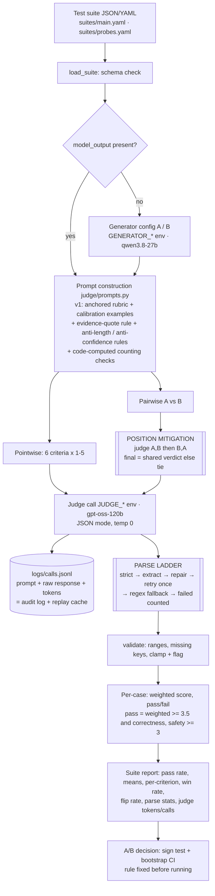

# P2 — LLM-as-Judge Evaluation Pipeline

Turns a test suite of `{input, system_prompt, model_output?, expected_output?, criteria?, context?}` into structured,
per-criterion verdicts and a suite report, compares two configs and declares a winner, and **measures its own biases**.
Every number below is backed by a file in [`results/`](results/) and every judge call by a line in the call log.

## Architecture



## Setup (≈5 minutes)

**Prerequisites:** Python 3.11+ (tested 3.13.15), any OS, internet. One or two [Groq](https://console.groq.com) API keys
(any OpenAI-compatible endpoint works; judge and generator can point to different providers).

```bash
cd p2_judge
python -m venv .venv && .venv/Scripts/activate        # macOS/Linux: source .venv/bin/activate
pip install -r requirements.txt
cp .env.example .env                                    # set JUDGE_API_KEY and GENERATOR_API_KEY
python -m unittest discover -s tests                    # 12 malformed-JSON parser tests
```

**Environment variables** (no secrets committed): `JUDGE_BASE_URL`, `JUDGE_API_KEY`, `JUDGE_MODEL`, `JUDGE_TEMPERATURE`,
`GENERATOR_BASE_URL`, `GENERATOR_API_KEY`, `GENERATOR_MODEL`, `GENERATOR_TEMPERATURE`, `CALL_LOG`.
Judge and generator are configured independently: separate URL, key, model and temperature.

## Run

```bash
# Suite in -> structured report out (generate with a config, or judge the suite's own model_output fields)
python -m judge.cli run --suite suites/main.yaml --gen configs/gen_v2.yaml --out results/run_v2.json

# A/B: prompt v1 vs prompt v2 -> pass rate, mean score, both-order pairwise win rate, declared winner
python -m judge.cli compare --suite suites/main.yaml --a configs/gen_v1.yaml --b configs/gen_v2.yaml
python -m judge.cli decide                      # recompute report + winner from saved run, no LLM calls

# Bias + validation experiments
python -m judge.experiments probes              # v0 vs v1 on 22 known-answer probe pairs
python -m judge.experiments suite_v0            # naive judge on the A/B outputs (score clustering 'before')
python -m judge.experiments self                # self-enhancement: two judges from different families
python -m judge.experiments retest              # test-retest (fresh, uncached draws)
python -m judge.experiments report              # -> results/bias_report.json + results/judge_validation.json

# Audit
python -m judge.cli replay --hash <request_hash> [--brief]   # print a logged judge prompt + raw response
python -m judge.cli reparse                                   # re-run the parser over every logged response
```

Re-running any command is free for calls already made: the call log is also a cache keyed by a hash of
(model, messages, temperature, max_tokens, json mode, sample index).

<!-- RESULTS -->
